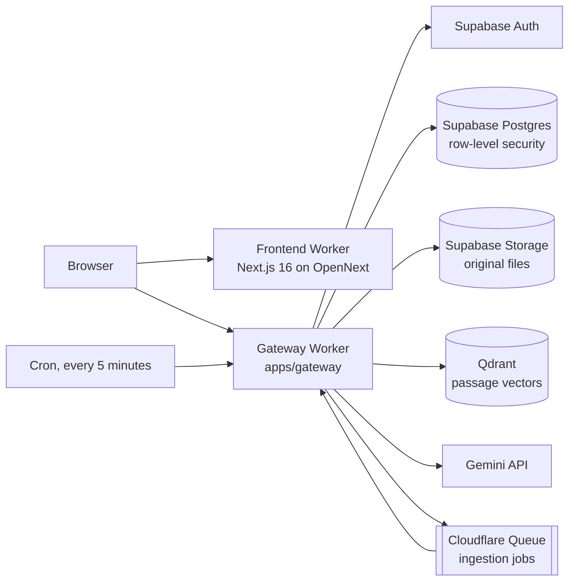

<p align="center">
  <a href="https://github.com/Anupam0202/NexusRAG/actions/workflows/v6-foundation-ci.yml"></a>
  
  
  
  
  
  
</p>

# NexusRAG

NexusRAG lets a team put its documents in a private workspace and ask questions about them. Every answer cites the
passages it comes from, so it can be checked, and an answer worth keeping can be saved as a finding, reviewed by a
colleague and exported with its evidence.

It runs on free tiers: a Cloudflare Worker gateway, a Next.js frontend on Cloudflare, Supabase for sign-in,
records and files, Qdrant for vector search, and Google's Gemini API for reading documents and writing answers.

## What it does

- **Workspaces and members.** Sign in with Google or GitHub, create a workspace, and add colleagues as
  administrators, editors or viewers. Everything (documents, conversations, findings, keys) belongs to one
  workspace and is never visible from another.
- **Documents.** Upload PDF, Word, text, Markdown, CSV, JSON, ZIP archives of text files, and PNG, JPEG, WebP or
  TIFF images, up to 10 MB each. A document is marked *Ready* only once it can actually be answered from.
- **Chat with citations.** Answers stream as they are written. Retrieval combines vector search with keyword
  matching inside the workspace; before an answer is saved, each cited passage is checked against the stored
  text, and the answer says when nothing in the documents supports a claim.
- **Research.** Plan a larger question in one of twelve modes (quick lookup, evidence answer, comparison,
  timeline, contradiction analysis, deep research, obligation analysis, entity investigation, due diligence,
  product passport, procurement research, calculation), run it, and see which sources were consulted and which
  were skipped. In a calculation, Gemini only points at the figures the documents state; every result is computed
  exactly and checked by the database, with its formula, units, rounding and the passages it came from.
- **Findings and review.** Save an answer as a finding, share it, have a second member approve it, and export a
  reproducible evidence package.
- **Privacy controls.** Deleting a document removes its search entries, stored file and every row, and leaves
  deletion receipts. Owners can set a retention period, delete a whole workspace, and anyone can delete their own
  account.
- **Your own Gemini key.** The repository ships no usable provider key. When an operator configures the service's
  key, each account gets a short trial on it (five questions and one document), limited by the provider
  rights and budget records the operator keeps; after that it uses its own Gemini key, which is stored encrypted
  and never returned to the browser. Google may bill the project that owns that key.

Products that are built but not yet verified end to end (Terms & Quota Radar, the Evidence API) stay out of the
navigation until they are switched on with `NEXT_PUBLIC_FEATURES`.

## Status

NexusRAG is under active development. The gateway, frontend and database have broad automated tests, and the
preview environment runs the current code. Verification of the full upload-to-answer journey on real services, and
the next production release, are still in progress. Current state, decisions and next steps are kept in
[docs/completion/PROGRESS.md](docs/completion/PROGRESS.md).

Known limits:

- PDFs and images are read by Gemini. A document whose text does not fit in one extraction response is refused
  with a message asking to split it; nothing partial is indexed.
- A document is split into at most 400 passages.
- The Workers free plan allows 10 ms of CPU and 50 outbound requests per invocation, so deletion, retention and
  ingestion work in small steps that a cron run every five minutes carries on.
- Free Qdrant clusters are suspended after a week without use and free Supabase projects pause after a week of
  low activity. The gateway's first cron run each day queries the index, which counts as use.

## Architecture



- The **gateway** (`apps/gateway/src/preview-worker.js` and the modules beside it) authenticates every request
  with Supabase Auth, checks workspace membership, and is the only component that holds service credentials.
- **Postgres** is the system of record: documents, versions, passages, conversations, findings, budgets and
  deletion receipts, each protected by row-level security. Most writes go through database functions that check
  the caller's role and the workspace's state in one transaction.
- **Ingestion** runs from the queue: extract text, split it into passages, embed them with
  `gemini-embedding-001` (768 dimensions), and publish a new document version only when the index holds exactly
  the expected entries.
- **Model choice** follows one policy in `apps/gateway/src/gemini-models.js`: `gemini-3.5-flash-lite`, then
  `gemini-3.1-flash-lite`, then `gemini-flash-latest`, falling back automatically when Google retires a model.
- **The cron** finishes deletions that could not complete in their request, carries out retention schedules,
  checks which Gemini models are still served, and keeps the search index awake.

The frontend uses Next.js 16 (Next.js requires Node `>=20.9.0`), React 19, TailwindCSS 4, Zustand and Lucide
icons. More detail: [docs/ARCHITECTURE.md](docs/ARCHITECTURE.md) and [docs/SECURITY.md](docs/SECURITY.md).

## Repository layout

| Path | Contents |
|---|---|
| `apps/gateway/` | The Cloudflare Worker that serves the API, the ingestion queue and the cron |
| `frontend/` | The Next.js app, built for Cloudflare with OpenNext |
| `supabase/` | The database baseline and forward migrations |
| `tests/cloudflare/` | Gateway tests (Node's test runner) |
| `tests/postgres/` | SQL assertions and the full local database replay |
| `tests/scripts/` | Tests for the release and migration tooling |
| `scripts/` | Release, migration, provider-review and smoke-test tools |
| `backend/` | The original FastAPI implementation, kept as a local research tool; it is not deployed |
| `docs/` | Architecture, security, deployment guides and the completion plan |

## Running it locally

CI uses Node.js 24 and Python 3.13; the database tests need PostgreSQL 17 (16 also works) with pgvector.

**Gateway tests** (from the repository root):

```bash
npm run test:cloudflare
```

**Frontend** checks, unit tests and builds:

```bash
cd frontend
npm ci --ignore-scripts
npm run lint && npx tsc --noEmit && npm test
npm run build && npm run cf:build
```

**Database replay**: builds a fresh database from the baseline and every migration, then runs all SQL assertions.
Use an empty, disposable database:

```bash
PGHOST=... PGPORT=... PGUSER=postgres PGDATABASE=nexus_replay bash tests/postgres/local-rehearsal.sh
```

**Release and migration tooling** tests:

```bash
python3 -m unittest discover -s tests/scripts -p 'test_*.py'
```

To run the app itself against your own services, create a Supabase project (apply
`supabase/baseline/001_v6_zero_cost_baseline.sql`, then the migrations in the order
`tests/postgres/local-rehearsal.sh` applies them), a Qdrant cluster and a Gemini key. Put the gateway's secrets in
`apps/gateway/.dev.vars` and start it with `npx wrangler dev --config apps/gateway/wrangler.preview.jsonc`, then
start the frontend with `npm run dev` in `frontend/` and the variables below.

## Configuration

Gateway (Worker variables and secrets):

| Name | Kind | Purpose |
|---|---|---|
| `SUPABASE_URL`, `SUPABASE_PUBLISHABLE_KEY` | variable | The Supabase project |
| `SUPABASE_SERVICE_ROLE_KEY` | secret | Server-side database and storage access |
| `QDRANT_URL`, `QDRANT_API_KEY` | secret | The Qdrant cluster |
| `QDRANT_COLLECTION` | variable | The collection for this environment |
| `GOOGLE_API_KEY` | secret | The service's Gemini key (trial use and the daily model check) |
| `GEMINI_USER_KEY_ENCRYPTION_SECRET` | secret | Encrypts users' own Gemini keys; must never change without a re-encryption plan |
| `GEMINI_MODEL`, `GEMINI_EMBEDDING_MODEL` | variable | Optional overrides of the model policy |
| `FRONTEND_ORIGIN` | variable | The frontend's origin, for CORS |

Frontend (read at build time):

| Name | Purpose |
|---|---|
| `NEXT_PUBLIC_SUPABASE_URL`, `NEXT_PUBLIC_SUPABASE_PUBLISHABLE_KEY` | The Supabase project, for sign-in |
| `NEXT_PUBLIC_API_URL` | The gateway's URL |
| `NEXT_PUBLIC_OAUTH_PROVIDERS` | Sign-in providers to offer, for example `google,github`; each needs its OAuth callbacks configured in Supabase Auth |
| `NEXT_PUBLIC_FEATURES` | Products in development to show, for example `radar,evidence-api` |

## Deployment

Nothing deploys automatically. A preview deploy is opt-in: a manual run of the Cloudflare Preview Deploy workflow
(GitHub environment `NexusRAG-Candidate-Preview`) or of `scripts/release.py`; a working preview is
not production acceptance. Production is released by a manual run of the Production Deploy workflow. Every release checks
`/health` and `/ready` on the new version and rolls back automatically on failure. The preview and production use
separate Workers, queues, collections and Supabase projects, and the release script refuses to mix them.

- Preview: [docs/DEPLOYMENT_FREE.md](docs/DEPLOYMENT_FREE.md)
- Production: [docs/DEPLOYMENT_PRODUCTION.md](docs/DEPLOYMENT_PRODUCTION.md)

## Security

Workspace isolation is enforced twice: by the gateway's membership checks and by row-level security in Postgres.
Service credentials stay in the gateway; documents are processed by Gemini only for workspaces whose owner has
approved it; every page and file is served with a content security policy and related headers. See
[docs/SECURITY.md](docs/SECURITY.md). Please report a vulnerability privately to the maintainer, Anupam0202, through
GitHub rather than in a public issue.

## Contributing

Issues and pull requests are welcome. Please keep changes focused, run the tests above for the parts you change,
and use [Conventional Commits](https://www.conventionalcommits.org/) for commit messages.

## Licence

[MIT](LICENSE)
